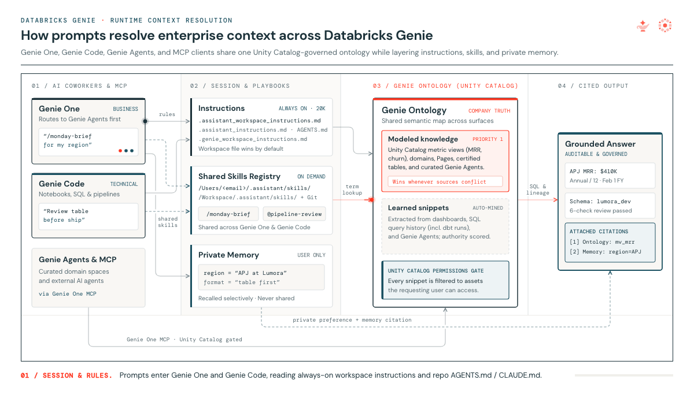
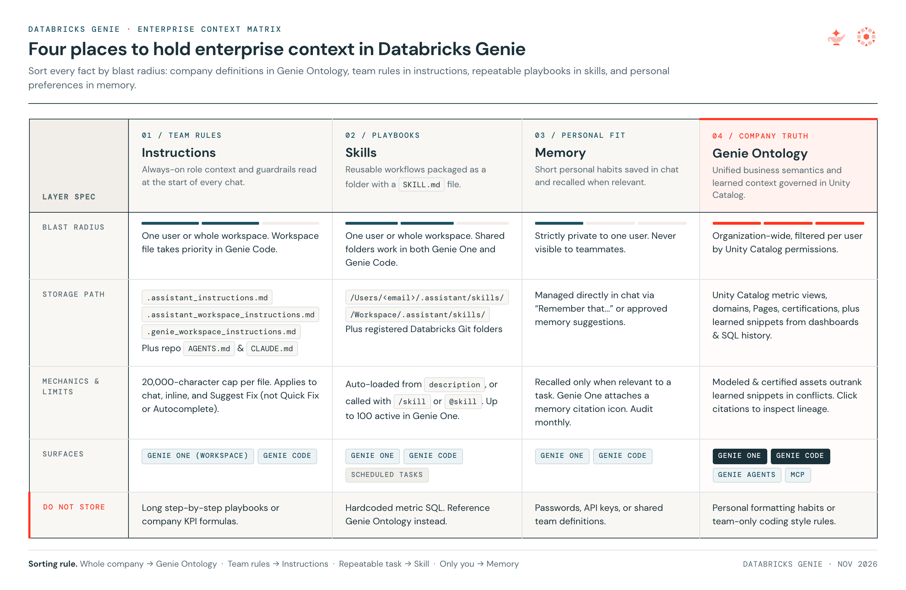
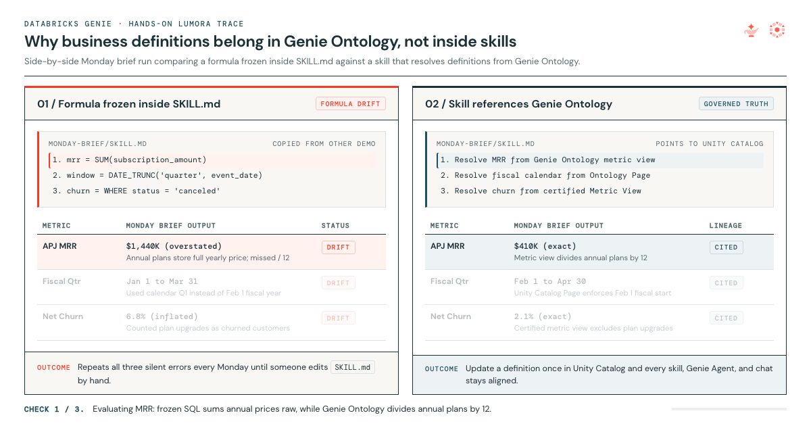

# Databricks Genie Enterprise Context Kit

*Build an enterprise knowledge factory across Databricks Genie One, Genie Code, and Genie Agents.*

Copy-pasteable starter templates for setting up enterprise context across **Databricks Genie One**, **Genie Code**, and **Genie Agents**: instructions files, open Agent Skills (`SKILL.md`), private memory prompts, and Unity Catalog Genie Ontology Pages.

> **Full Guide & Walkthrough:** Read the complete article on Towards AI — **[Giving Your AI Coworker Enterprise Context with Databricks Genie](https://pub.towardsai.net/giving-your-ai-coworker-enterprise-context-with-databricks-genie-a3bc8113790f)** — for the full architecture breakdown, comparison with RAG and standalone semantic layers, hands-on test findings, 8-step team rollout checklist, and FAQ.



---

## The Four-Layer Sorting Rule

Every piece of enterprise context belongs in one specific layer based on who it applies to:

- **Whole company** -> **Genie Ontology** (Unity Catalog metric views, domains, Pages, certifications, and learned snippets)
- **Team or workspace rules** -> **Instructions** (Markdown files read on every chat, up to 20,000 characters per file)
- **Repeatable tasks** -> **Skills** (`SKILL.md` playbooks loaded on demand, shared across Genie One and Genie Code)
- **Only you** -> **Memory** (private per-user preferences saved in chat and cited when used)



For the full explanation of precedence rules, Unity Catalog permissions, and conflict resolution, see [the full guide on Towards AI](https://pub.towardsai.net/giving-your-ai-coworker-enterprise-context-with-databricks-genie-a3bc8113790f).

---

## Repository Structure

```text
databricks-genie-enterprise-context-kit/
├── instructions/
│   ├── .assistant_instructions.md              # Genie Code user instructions (/Users/<email>/)
│   ├── .assistant_workspace_instructions.md    # Genie Code workspace instructions (/Workspace/)
│   ├── .genie_workspace_instructions.md        # Genie One chat workspace instructions (/Workspace/)
│   └── AGENTS.md                               # Folder-level rules auto-discovered by Genie Code
├── skills/                                     # Register directly in Genie Code -> Customizations > Skills
│   ├── pipeline-review/
│   │   └── SKILL.md                            # 6-check pre-ship table review playbook
│   └── monday-brief/
│       └── SKILL.md                            # Ontology-backed weekly regional brief playbook
├── ontology/
│   ├── active_customer_page.md                 # Unity Catalog Page template for "Active customer"
│   ├── mrr_and_churn_page.md                   # Unity Catalog Page template for MRR & net churn
│   └── fiscal_calendar_page.md                 # Unity Catalog Page template for a Feb 1 fiscal year
├── memory/
│   └── monthly_memory_audit_prompts.md         # Copy-paste prompts to save, inspect, and prune memory
└── examples/
    └── anti-pattern-monday-brief-hardcoded/
        └── SKILL.md                            # What breaks when a skill freezes SQL formulas
```

---

## Quick Start in Databricks

### 1. Add Instructions
- **Personal (Genie Code):** Copy [`instructions/.assistant_instructions.md`](instructions/.assistant_instructions.md) to `/Users/<your-email>/.assistant_instructions.md`.
- **Workspace (Genie Code, admin):** Copy [`instructions/.assistant_workspace_instructions.md`](instructions/.assistant_workspace_instructions.md) to `/Workspace/.assistant_workspace_instructions.md`.
- **Workspace (Genie One chat, admin):** Copy [`instructions/.genie_workspace_instructions.md`](instructions/.genie_workspace_instructions.md) to `/Workspace/.genie_workspace_instructions.md`.
- **Project repo (Genie Code):** Copy [`instructions/AGENTS.md`](instructions/AGENTS.md) into your Databricks Git folder root.

### 2. Load the Shared Skills in Both Genie Code and Genie One
You can use either method:
- **Git folder registration (recommended for teams):** Clone this repo into a Databricks Git folder, then open Genie Code -> **Customizations** -> **Skills** -> **New** -> **Add from workspace folder** and select the `skills/` directory. Registered skill folders appear in both Genie Code (`@pipeline-review`) and Genie One (`/monday-brief`).
- **Default skill folders:** Copy the folders inside `skills/` to `/Users/<your-email>/.assistant/skills/` (personal, shared across Genie One and Genie Code) or `/Workspace/.assistant/skills/` (everyone in the workspace).

### 3. Keep Business Definitions in Genie Ontology, Not Inside Skills

In hands-on testing on a fictional SaaS workspace (Lumora), letting a skill hardcode SQL for MRR and churn froze three silent errors that would have repeated every Monday.



Compare [`examples/anti-pattern-monday-brief-hardcoded/SKILL.md`](examples/anti-pattern-monday-brief-hardcoded/SKILL.md) with the fixed [`skills/monday-brief/SKILL.md`](skills/monday-brief/SKILL.md) and the Unity Catalog templates in [`ontology/`](ontology/).

### 4. Audit Private Memory Monthly
Use the prompts in [`memory/monthly_memory_audit_prompts.md`](memory/monthly_memory_audit_prompts.md) to inspect and prune stale preferences in both Genie One and Genie Code, and keep secrets or shared KPIs out of memory.

---

## Reference & Citation

If you use these templates or reference the four-layer context pattern in your team docs, please cite the companion article:

- **Article:** Praneeth Paikray, *[Giving Your AI Coworker Enterprise Context with Databricks Genie](https://pub.towardsai.net/giving-your-ai-coworker-enterprise-context-with-databricks-genie-a3bc8113790f)*, Towards AI (Oct 2026, updated Nov 2026).
- **Official Databricks Docs:**
  - [Customize Genie Code with instructions](https://docs.databricks.com/aws/en/genie-code/instructions)
  - [Extend Genie Code with agent skills](https://docs.databricks.com/aws/en/genie-code/skills)
  - [Remember context across sessions with Genie Code memory](https://docs.databricks.com/aws/en/genie-code/memory)
  - [Chat in Genie One](https://docs.databricks.com/aws/en/genie-one/chat)
  - [Skills in Genie One](https://docs.databricks.com/aws/en/genie-one/skills)
  - [Genie Ontology](https://docs.databricks.com/aws/en/genie/genie-ontology)

---

*Disclosure: I work at Databricks. Opinions here are my own. Lumora and all example datasets in this repository are fictional.*
